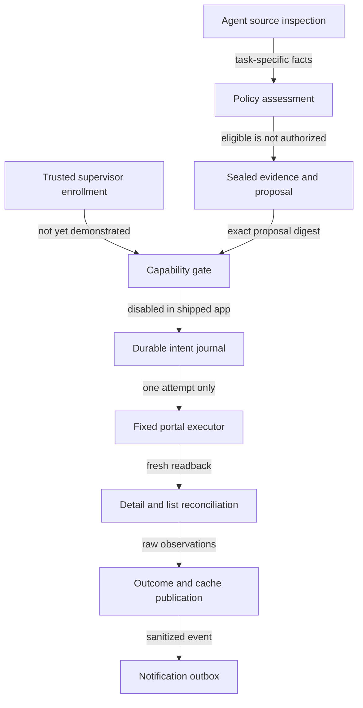

# Agent-only completion: operator and integration guide

**Current release mode: assessment-only. Live completion is unavailable.**

This guide covers the implementation created from the [master plan](../../.hermes/plans/2026-10-26_132306-agent-only-task-completion-master-plan.md). Tests and handoff evidence are separate from live readiness. See [completion verification](COMPLETION-VERIFICATION.md) for final results and blockers.

## What is available

| Surface | Behavior | Authority |
|---|---|---|
| PES desktop Settings | Read-only completion observer, enrollment blocker, journal operation/discrepancy counts, raw `Update Task` count when full source rows exist | Cannot complete or retry tasks |
| Existing Sync and Ctrl+R | Read PES, validate snapshot, preserve raw fields, publish cache/projection | No task mutation |
| Read-only stdio MCP adapter | List cached rows, inspect exact task, hypothetical deterministic assessment, report readiness | `authorizedToCommit=false` for every result |
| Internal completion components | Policy, evidence staging, journal, capability and fixed portal driver; testable internal orchestration | Not registered as a desktop IPC or live agent tool |

No Complete button, mutating IPC, commit MCP tool, automatic schedule, background service or new Hermes plugin is installed. Direct secure sign-in does not trigger completion. Opening a task folder or copying context does not trigger completion.

## Read-only agent adapter

Build from `C:/Workspace/pesautomation/desktop`:

```bash
npm run build
node dist/main/agent/stdio.js --snapshot "C:/absolute/path/to/snapshot.json"
```

The `--snapshot` argument must reference an actual snapshot JSON object—not `workspace.json` (which wraps it), a task record, or the projection index. Read `data/agent-workspace/index.json` first and resolve its immutable `snapshotPath`. No snapshot path is implicitly discovered. No per-tool file path, network URL, browser script or command is accepted.

The process speaks MCP JSON-RPC over stdin/stdout using the official installed SDK. It holds the selected immutable snapshot in memory for its lifetime. Restart the adapter on a newer committed snapshot; it does not watch cache files or silently claim a live refresh.

Tools:

| Tool | Arguments | Meaning |
|---|---|---|
| `pes_list_candidates` | optional `offset`, `limit` (1–100), exact raw `status` | Lists cached records; not a declaration they are completed |
| `pes_get_completion` | exact `taskNo` | Cached source task/raw cells; not a journal operation lookup or remote verification |
| `pes_assess_completion` | schema-validated `assessment` object | Hypothetical policy result from explicitly untrusted client assertions |
| `pes_completion_readiness` | empty object | Assessment-only readiness, provenance/freshness/scope limitations |

`pes_commit_completion`, enrollment, upload, arbitrary file reads and script execution are absent and rejected. `eligible=true` from hypothetical assessment does **not** authorize writing: results always disclose `authorizedToCommit=false`, `AGENT_ENROLLMENT_UNVERIFIED`, `sourceVerification=not_performed`, and unverified cache binding.

A cached snapshot may be imported, older than five minutes, future-dated, or partial. Legacy caches may declare 32 scanned but contain eight retained active tasks. The adapter reports this explicitly. When `sourceRows` exists it includes all captured statuses including `Update Task`; active filter disappearance is never proof of completion.

**Built is not connected:** no Hermes configuration was changed. Any later MCP registration must use the supported connection workflow and obtain the user's authorization. Connecting the read-only adapter does not resolve live enrollment.

## Intended completion lifecycle and implemented boundaries



The diagram is a component/lifecycle description, **not proof of live end-to-end wiring**. The desktop does not instantiate a live completion dispatcher. Missing trusted enrollment and independently verified source/policy inputs deliberately block commit registration.

### Evidence and dates

- Completion must match the PES goal: BE development completed is distinct from QA passed or deployed.
- Overdue dates, merged PRs, local notes and old assistant summaries are insufficient on their own.
- Source assertions must be verified by a trusted host integration before future live commit. Model-supplied `approvedBy`, `underLock`, provenance strings or session labels do not grant trust.
- PNG intake accepts bytes, not a path to an arbitrary file. Staging uses task-bound hash paths and immutable manifests, bounded PNG pixel decoding, and compressed-stream integrity checks. Image validity does not establish authentic provenance, absence of secrets, or proof of completed work.
- Evidence must be reviewed for secrets and task identity. Rendered summaries must not be called original screenshots.
- `target_date` is the requested reporting policy, not a reconstructed historical completion timestamp. Future finished dates are refused. Target dates themselves are never edited.

### Portal safety

The fixed driver resolves the current row by exact TaskNo, validates detail/source/PIC/target, selects Selesai, stages the target-matching finished date, verifies the selected file, and performs each Update and Upload at most once per driver instance. Durability and replay protection require the journal/engine—not the driver's in-memory guard alone.

The driver uses a narrow injected main-process transport. Its artificial Chromium fixture intercepts HTTPS locally, consumes actual browser File bytes, and tests asynchronous/full-navigation behavior. This is DOM contract evidence, **not an authenticated PES backend test**. The actual app's read-only portal remains the only registered remote workflow.

### Crash and recovery

- Flush intent before irreversible actions.
- A crash/timeout after intent means uncertain outcome, never permission to repeat Update or Upload.
- Reconciliation opens saved views without restaging/submitting/uploading.
- Preserve remote result separately from cache/projection refresh and notification delivery. Local failures cannot reset remote completion.
- File fsync is used; Windows directory metadata durability and exactly-once remote delivery are not guaranteed.
- Journal hash chains detect corruption; malicious same-user rewriting/tail deletion and hostile concurrent path swapping are outside the guarantee.
- Process/profile ownership and safe directories remain mandatory; ordinary UI isolation does not protect against a fully compromised Windows account.

## Known PES discrepancies: do not hide or retry

Historical evidence: `C:/Workspace/pesautomation/reports/completion-20261026/`.

| Task | Saved detail | List / Info | Handling |
|---|---|---|---|
| `M03989/Task. IT/1026` | Selesai; FinishDate October 23, 2026 | List Solved; TglSelesai October 26 | Discrepancy retained, no date rewrite |
| `M03990/Task. IT/1026` | Selesai; FinishDate October 23; target row Solved | List/Info Update Task; list finish blank | Quarantine; no second completion |

List `Task. IT` and detail `Task.IT` identifiers are preserved as separate exact strings. Do not normalize malformed or mismatched tokens. Approved preflight can have list `Approval`, detail dropdown `T1`, target row `Approved`; eligibility accepts that explicit mapping only with the matching raw target status, not a blanket equality/normalization rule.

The new journal does not retroactively claim to have executed the historical manual-agent operations. Their original reports remain the source; new current state requires actual readback.

## Remaining live-enablement gates

1. Demonstrate a trusted supervisor-to-adapter bootstrap and run lifecycle; session/env labels, ordinary MCP connections and same-user pipe ACLs alone are insufficient.
2. Provide independently verified source facts and standing policy through that trusted host, not client claims.
3. Implement and exercise the dedicated portal transport/verification mapper in the actual app under shared ownership; preserve missing fields as unknown.
4. Resolve or explicitly approve PES view semantics without silently ignoring Store/FIFO conflicts.
5. Obtain final independent exact-source security approval, then separately authorize one newly eligible live canary. Never reuse locked Store/FIFO as experiments.
6. Verify remote readback, attachment assurance, real desktop cache/projection refresh and notification delivery independently.

No configuration flag or `actor=agent` parameter may bypass these gates.
