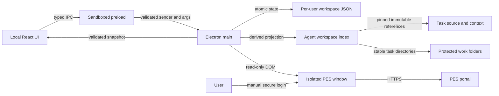

# Architecture — PES

## Decision

Electron 45, React 19, TypeScript and Vite. Versions were resolved against the package registry when implementation began; lockfile pins the installed graph. Electron embeds the browser needed for the modern desktop shell and the legacy ASP.NET portal, avoiding a separate Python runtime, browser download or private Hermes API inside the delivered application.

There is no requirement for a server, cloud database, external AI provider, administrator-level installation or unattended browser access. Per-user portability matters more than minimizing the Chromium bundle size.

## Security boundary

The local renderer has context isolation and sandbox enabled, no Node integration, CSP, no remote fonts/scripts, no arbitrary file-read API, and no arbitrary URL opener. IPC requires the actual main window and its main frame. The remote portal has no preload, no Node integration, denied permissions/downloads/new windows, and origin-restricted navigation. Source text is rendered through React rather than injected HTML.

Credentials are entered by the user directly on the official PES page, not collected by a React password form or read from an agent's private credential store. Browser session data stays in the dedicated app profile. Application task/activity files contain operational data and must not be published.

## Persistence and provenance

Application state separates source snapshots, local preferences, settings, activity history, and runtime sync state. A valid snapshot is published only after complete extraction and validation. The state store uses a temporary file and atomic replacement; a failed validation/write must not replace the last good in-memory/disk snapshot.

Snapshots carry source (`imported` or `live`), original retrieval time, exact scope, scanned count and tasks. Changes in extraction scope are not presented as remote task deletions. A task missing from the current active snapshot is not declared solved. Local pin/focus data is keyed by stable TaskNo and survives disappearance.

## Sync lifecycle

Only one sync runs at once. Repeated requests join the same operation. Cancellation is cooperative and checked before snapshot publication. Progress shows real stages/counts, not simulated percentages. Failure preserves the prior snapshot and records a sanitized event.

The independent adapter reproduces the verified List/dept/PIC/date/Preview workflow. It instruments ASP.NET postback completion instead of trusting document-load timing, verifies exact filters, maps the 16-column schema, validates PIC and task identities, reads the Info panel per selected task, and follows recognized ASP.NET page actions. Unrecognized paging must not be silently treated as a complete success. Live evidence for the user's actual portal is separate from fixture and parser coverage.

## Deadlines

A PES due date is a civil date, not a timestamp. The app uses an explicitly disclosed local convention: due through that local date, overdue at the following midnight in the selected timezone. Default timezone is Asia/Jakarta; this is an application preference, not a verified server policy. Countdown calculations always use current wall-clock time and are refreshed after visibility/focus and periodically, avoiding sleep drift.

## Browser and account limitations

The user's existing Hermes login is not automatically shared with this application. The first live sync may therefore require a manual sign-in. Portal authentication challenges and site-specific browser behavior remain real external gates. No direct task mutation APIs, startup scheduler, cloud sync, AI scoring or attachment upload are included.

## Agent completion boundary

New completion modules are internal and tested independently from the registered read-only portal. Main-process startup exposes a **read-only completion observer** and shares portal ownership across sync/connection. It does not register or instantiate a live completion dispatcher. The separate stdio MCP adapter exposes cached reads and hypothetical policy assessment only. No human Sync action, login, startup or renderer callback can request a completion.

Trusted supervisor enrollment and actual live completion transport/mapper integration remain blocked. See [Agent completion](AGENT-COMPLETION.md) and [completion verification](COMPLETION-VERIFICATION.md). Pure policy eligibility and fixture principals are not authorization evidence. Historical Store/FIFO list/detail disagreements are retained rather than normalized.

## Primary references

Official Electron security, webContents and session documentation were retrieved during implementation:

- `https://www.electronjs.org/docs/latest/tutorial/security`
- `https://www.electronjs.org/docs/latest/api/web-contents`
- `https://www.electronjs.org/docs/latest/api/session`

Captured reference responses are local verification material, excluded from the portable package. They support architecture decisions, not proof that the app's implementation is correct; tests and runtime evidence supply that proof.
