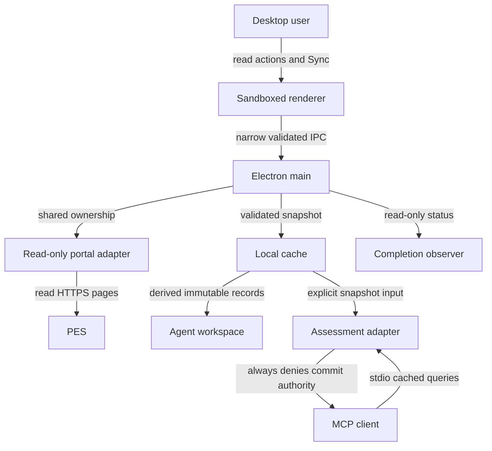
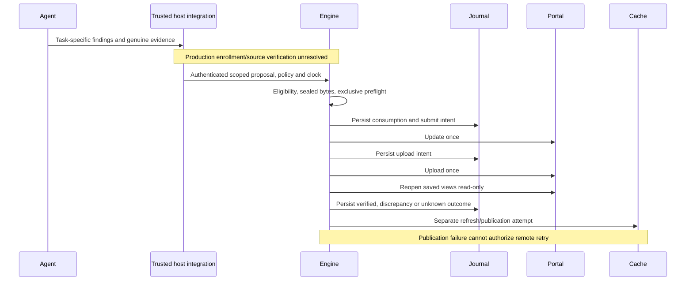
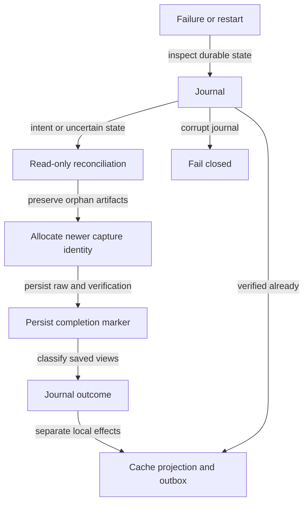

# PES automation — full implementation, task-update and verification report

**Report date:** October 26, 2026, Asia/Jakarta (UTC+07:00).  
**Evidence checkpoint:** local inspection began at 20:26:50 UTC+07:00. The final assessment handoff was recorded at 20:14:48 UTC+07:00.  
**Workspace:** `C:/Workspace/pesautomation`  
**Desktop project:** `C:/Workspace/pesautomation/desktop`  
**Resumed source session:** `local-4a21047024d75e735d42b7157c53394433c6bfdbaa224dd9a11c2d1db43ae360`

> **Overall decision:** The repaired candidate is independently approved for **assessment-only delivery**. It is not a functioning live autonomous completion service. No live PES writes were performed during the resume. The installed release and its shortcuts were not replaced. Earlier manual-agent task updates did occur and are documented separately below.

## 1. Executive summary

The work has two distinct outcomes:

1. **Historical portal updates:** Inventory Store and Inventory FIFO were submitted through PES earlier on October 26. Both saved detail forms showed `Selesai` with finished date `23-Okt-2026` and evidence attachment names. Other PES views contradicted parts of those details. Store's list finished date differed; FIFO remained `Update Task` in the list and Info. Neither operation was repeated. These observations do not prove that FIFO finalized consistently across PES.
2. **Agent-only completion implementation:** Local policy, evidence staging, capability, journal, portal ownership, fixed DOM driver, saved-view verification, notification outbox, observer and read-only MCP components were built and tested. The desktop deliberately does not register a live completion dispatcher. Trusted enrollment, production source verification and production completion integration remain missing.

The resumed session recovered an interrupted independent review, found and fixed a real restart-recovery bug, rebuilt the separate candidate, reran verification, and obtained exact-source assessment-only approval.

### Final status matrix

| Area | Status | Meaning |
|---|---|---|
| Local source and completion components | LOCAL_VERIFIED | Implemented and tested, not a live deployment |
| Unit/regression suite | PASS | 369 tests across 18 files; zero failures |
| Typecheck and build | PASS | Actual commands executed successfully |
| MCP protocol | PASS | Five actual subprocess protocol tests; read-only boundary enforced |
| Chromium completion contract | PASS | Artificial intercepted fixture; not real PES backend proof |
| Packaged candidate | LOCAL_VERIFIED | Rebuilt, inspected and launched with isolated test data |
| Independent review | APPROVED_ASSESSMENT_ONLY | Exact repaired source set; no scoped security/logic defects |
| Existing installed release | UNCHANGED | Candidate did not replace launch targets |
| Live agent enrollment | BLOCKED | No proven trusted supervisor integration |
| Live autonomous task completion | BLOCKED | No registered production completion dispatcher/transport |
| Live canary | NOT RUN | Requires separate authorization and fulfilled prerequisites |
| Desktop cache after historical writes | NOT REFRESHED in recorded task-update audit | Portal readback is not cache refresh |
| External notification delivery | NOT IMPLEMENTED/NOT VERIFIED | Outbox fixtures are not actual delivery |
| Git commit/push | NOT AVAILABLE | Current inspection confirmed no Git repository |

## 2. Evidence boundaries and freshness

This report summarizes local source, preserved reports, command results and independent reviews. **No new PES website query was made for this report.** Historical task counts/statuses below are observations at their recorded checkpoint, not claims about the portal now.

During report preparation, all 74 pinned source hashes were checked again with zero mismatches. The candidate exists and its `app.asar` hash still matches the final handoff. This fresh integrity check is separate from the prior test executions; the full suite was not rerun merely to generate this document.

Evidence precedence is: actual saved observations/source and command output, then exact-source review, then handoff metadata, then explanatory prose. A historical assistant summary alone is not completion proof.

## 3. Earlier live PES task-update outcome

**Source:** `../reports/completion-20261026/summary.json` and `RESULT.md`, relative to the parent automation workspace. The summary's verification timestamp is **October 26, 2026 at 13:19:31 UTC+07:00**.

| Record | Saved detail | Other recorded views | Conclusion |
|---|---|---|---|
| `M03989/Task. IT/1026` — Inventory Store | `Selesai`, FinishDate `23-Okt-2026`; attachment `evidence_base_inventory_store.png` | List `Solved`, list TglSelesai `26-Okt-2026` | Saved-state date discrepancy retained; not rewritten |
| `M03990/Task. IT/1026` — Inventory FIFO | `Selesai`, FinishDate `23-Okt-2026`; target table `Solved`; attachment `evidence_base_inventory_fifo.png` | List and Info `Update Task`; list TglSelesai blank | Inconsistent/intermediate result; no conclusive all-view finalization claim |

Both detail finish dates matched their target dates. Update controls were disabled afterward. A disabled control is a no-retry boundary, not proof that every persisted view agrees.

The historical audit compared 32 grid records before/after while ignoring row order: only the two named records changed and 30 remained unchanged. Its final distribution was **25 Solved, 6 Approval, 1 Update Task**. The six remaining Approval tasks had future targets and were left untouched. No zero-overdue claim is justified because FIFO remained unresolved.

### Historical evidence provenance

The recorded task association came from the October 23 Asana update history with exact source-task links matching the PES forms. The two uploaded PNGs were previously approved **rendered evidence summaries, not original screenshots**:

| Evidence | SHA256 |
|---|---|
| `C:/Workspace/Deliverables/evidence_base_inventory_store.png` | `788ab0371bf6d4f60750b44484e419088d530dcb4f07d4b217ce08e8ec4fed70` |
| `C:/Workspace/Deliverables/evidence_base_inventory_fifo.png` | `2afa1d37f6ad8e3950c1f1a3c1e5ff642bd97b3e81b0ece9d82b6e86d226b662` |

These are checksums recorded in the historical audit, not newly recomputed attachment-server checksums. Recorded attachment filenames are not proof of server-side byte identity. The newer engine journal does not retroactively claim to have executed these historical operations.

## 4. What was built

| Component | Responsibility | Boundary |
|---|---|---|
| `src/shared/completion-types.ts` | Explicit proposal, identity, policy, raw date/view and verification contracts | Data types do not grant authority |
| `src/main/completion-policy.ts` | Deterministic eligibility, freshness, status mapping, source/goal/evidence/date gates | Pure assessment is not authentication or provenance verification |
| `src/main/agent-capability.ts` | Scoped internal authority and capability consumption | Production trusted enrollment remains unresolved |
| `src/main/portal-coordinator.ts` | Shared ownership of portal workflows | Host process/single-instance ownership remains required |
| `src/main/completion-evidence.ts` | Task-bound evidence bytes, hashes, manifests, safe staging and bounded PNG decoding | Valid image content is not proof of real work |
| `src/main/completion-journal.ts` | Durable operation state and intent history | Corrupt journal fails closed; not adversarial same-user tamper protection |
| `src/main/completion.ts` | Prepare, gated commit, one-attempt orchestration, read-only reconciliation and publication | Internal engine; not registered as live dispatcher |
| `src/main/portal-completion.ts` | Fixed inspection/staging/update/upload browser contract | Production transport not wired; tested with artificial Chromium fixture |
| `src/main/completion-verification.ts` | Compare reopened list/detail/target/Info and attachment observations | Missing stays unknown; conflicting stays discrepancy |
| `src/main/completion-notifications.ts` | Durable deduplicated notification outbox | Real external sender not installed |
| Completion observer | Read-only status/blockers in desktop Settings | No Complete/Retry action or mutation preload API |
| `src/agent/` | Stdio MCP cached reads and hypothetical assessment | No commit tool; not connected to Hermes |

The existing desktop retains task search/filter/detail views, local pin/focus, activity, settings/themes, offline snapshots, exports and a read-only PES synchronization workflow. Dedicated browser login remains manual and separate from task authorization.

## 5. Architecture and end-to-end flow

### Registered application surfaces



This diagram describes implemented surfaces, not a configured Hermes connection. The MCP adapter must be started with an explicit snapshot path; it does not discover credentials or imply fresh portal data.

### Intended completion pipeline — not live-wired



### Recovery decision



Exactly-once remote delivery is not claimed. The implemented safety objective is at-most-one automatic mutation attempt with durable uncertainty and read-only recovery.

## 6. Policy and safety invariants

- Exact list/detail IDs are preserved separately. `Task. IT` and `Task.IT` are not silently normalized; their association requires explicit identity/source mapping.
- Current policy checks the intended PIC `3220` and department `32`, goal, source-task link, target revision and allowed writable state.
- The specific observed mapping `Approval` list / `T1` detail / `Approved` target row may qualify. A bare `T1` does not establish eligibility.
- Overdue status, merged code, disappearing active rows or assistant summaries are insufficient completion proof. Development completion is distinct from QA/deployment completion.
- Trusted host inputs must supply policy, clock, fresh observations and verified source facts. Client strings such as `approvedBy`, `underLock` or actor/session labels are not authority.
- Target-date finish reporting requires approved policy and an unchanged exact target. Future finish dates are rejected. Observed completion time remains separate from reporting date.
- Evidence is staged as validated task-bound bytes, not an arbitrary caller-selected profile/file path. Hashes bind bytes but do not establish authentic provenance or secret review.
- Every irreversible action requires persisted intent first. Uncertain submission/upload outcomes are never automatically repeated.
- All-status observations are needed to retain `Update Task` records; Approval/Open-only filtering can hide unresolved writes.
- Cache freshness, remote result, projection status and notification delivery are separate facts.

## 7. Review chronology and resolved findings

| Stage | Outcome |
|---|---|
| Preliminary reviews | Identified detail-goal integrity, PNG validation, protocol/schema and engine recovery issues |
| Prior fixes | Exact goal/department/posted-field guards, strict MCP targetStatus, valid civil-date comparison, bounded PNG decode, guarded post-VERIFIED publication errors |
| Interrupted final review | Rate-limited before a verdict; no approval inferred |
| Resume baseline | 353 tests/18 files, typecheck/build, five MCP tests, Chromium fixture and packaged checks passed |
| First completed final review | Failed on FINAL-RECOVERY-001 despite green suite |
| Regression-first repair | Actual reproducing RED, minimal recovery fix, expanded tests and GREEN |
| Revised validation | 369 tests/18 files, typecheck/build and rebuilt candidate checks passed |
| Fresh exact-source review | Approved assessment-only; all 74 hashes matched before/after |

### FINAL-RECOVERY-001: root cause and fix

Previously, immutable readback and verification filenames depended on the journal event count. If raw persistence succeeded or partially created a file and later persistence failed, the journal stayed `VERIFYING`. A restarted engine selected the same filename and exclusive creation failed with `EEXIST`. It could not reconcile even after storage recovered.

The repair advances capture identity above the global journal length and all existing numeric raw/verification/completion-marker identities. Orphan contents need not parse to reserve their names. Existing artifacts remain untouched. Raw and verification records are persisted before a fsynced completion marker; result selection uses completed capture identities rather than the lexically last orphan JSON. Legacy journal-confirmed markerless pairs remain supported.

Tests exercise raw creation, partial write, raw fsync, verification creation, marker interruption and interruption before outcome transition. A fresh engine **and reopened journal** recover read-only. Repeated reconciliation and commit replay preserve exactly one submit and one upload in the synthetic scenarios. The reviewer also checked legacy recovery and ordering, including identities beyond the old padding width.

Fail-closed storage/journal latches, immutable writes, unresolved-account circuit behavior and mutation restrictions were not weakened. Torn journal repair and Windows power-loss directory durability are still not promised.

## 8. Verification evidence and limits

| Check | Observed result | What it does not prove |
|---|---|---|
| 369 Vitest tests / 18 files | Zero failures; parent and reviewer runs | Live task correctness |
| Typecheck/build | Successful real execution | Production integration |
| Five stdio protocol tests | Initialize/ping/list/call, validation, read-only tools | Trusted agent enrollment or configured connection |
| Chromium fixture | Actual CDP File attachment and postback/navigation behavior with HTTPS intercepted | PES server save semantics or remote attachment hash |
| Packaged observer | No completion authority/button; Sync read-only; import untouched | Live autonomous operation |
| Packaged desktop | UI/persistence/export/IPC/isolation and failed-sync retention checks passed | Fresh portal data |
| ASAR inspection | Required compiled files match build; no forbidden paths | Signing, installation or remote deployment |
| Exact-source review | Scoped assessment-only approval, empty issue lists | Approval of future source changes or live canary |

The preserved real-cache MCP smoke read eight Approval records from a snapshot retrieved at `2026-10-26T02:58:32.749Z`. It explicitly reported stale, partial-active-task scope, unchanged cache and `authorizedToCommit=false`. Its `source=live` describes the original retrieval, not a live query by MCP.

## 9. Artifact identity and delivery

| Artifact | Value |
|---|---|
| Candidate executable | `C:/Workspace/pesautomation/desktop/release/assessment-candidate/PES-win32-x64/PES.exe` |
| Source manifest | `verification/completion-recovery-source-manifest.json` |
| Source-set SHA256 | `75511bbb7a9fdc9ad74232ff50279fb5f85f1ca235901a8b6301f3a77dac8e79` |
| Candidate app.asar SHA256 | `7731dd89f82907db7a2ca8c582e25212247e1f284e63cea0b0dae0c83c69677a` |
| Unchanged runtime executable SHA256 | `50c96d1603b345f228e57ec55b43df34ca377a575376f15a5576af38bbe726f3` |
| Candidate package version | `0.2.0-assessment.1` |
| Consolidated handoff | `verification/completion-assessment-handoff.json` |
| Final approval | `verification/completion-recovery-final-review.json` |
| Preserved failed review | `verification/completion-final-review.json` |

The source-set identity is SHA256 of the manifest's compact sorted-key JSON files array, preserving array order. It is **not** the raw manifest file checksum. Runtime EXE identity alone does not identify application payload; pair it with the ASAR hash.

Keep the complete portable folder together. Do not copy only PES.exe. The package is not signed by this work, no installer deployment is claimed, and no existing launcher was repointed. This report does not authorize candidate promotion.

## 10. Operator reference

Run from `C:/Workspace/pesautomation/desktop`:

```bash
npm test -- --maxWorkers=1 --testTimeout=20000
npm run typecheck
npm run build
node tests/agent-stdio.e2e.cjs
node node_modules/electron/cli.js tests/portal-completion.dom.e2e.cjs
```

Packaged checks use isolated data via the harness:

```bash
PES_PACKAGE_FOLDER=C:/Workspace/pesautomation/desktop/release/assessment-candidate/PES-win32-x64 node scripts/inspect-package.cjs
PES_FOCUS_TEST_EXECUTABLE=C:/Workspace/pesautomation/desktop/release/assessment-candidate/PES-win32-x64/PES.exe node tests/completion.packaged.e2e.cjs
PES_FOCUS_TEST_EXECUTABLE=C:/Workspace/pesautomation/desktop/release/assessment-candidate/PES-win32-x64/PES.exe node tests/desktop.e2e.cjs
```

These commands are local verification, not a completion command. The candidate must exist first. Do not substitute the real user profile for isolated test storage.

Read-only MCP entry point:

```bash
node dist/main/agent/stdio.js --snapshot "C:/absolute/path/to/snapshot.json"
```

The snapshot path is illustrative; resolve the actual immutable `snapshotPath` through `C:/Workspace/pesautomation/data/agent-workspace/index.json`. Do not pass workspace.json, an index, or a task file as if it were the snapshot. The four tools are `pes_list_candidates`, `pes_get_completion`, `pes_assess_completion`, and `pes_completion_readiness`. There is no commit/upload tool. Restart the adapter to select a newer snapshot.

## 11. Preservation, rollback and residual housekeeping

- Existing launch release and shortcuts remain in place; there is no candidate deployment to roll back.
- Original extraction snapshots, task-update audit and failed review remain preserved.
- Prior baseline source/profile backups are referenced under `verification/completion-baseline-20261026/`. Their restoration was not exercised in this report.
- Preserve `%APPDATA%/PES Focus`, its dedicated browser partition, workspace.json, user pin/focus/settings and agent task work folders. Do not distribute authentication profiles.
- Fresh inspection confirmed no Git repository at the desktop project; no commit/push or remote backup is claimed.
- A residual `.implementation.lock` marker remains and names the original resumed session's `agent-only-completion` mission. It is a file marker, not evidence of an active process. This reporting pass left it untouched; it should be reconciled with any future implementation owner before another write session.

## 12. Remaining live-enablement gates

| Order | Required work | Acceptance evidence |
|---|---|---|
| 1 | Trusted supervisor enrollment/bootstrap and run lifecycle | Actual authenticated runtime boundary; no actor/env-label bypass |
| 2 | Authoritative source verification and host-owned policy | Exact task/goal/revision/provenance checked outside client assertions |
| 3 | Production completion transport and saved-view mapper | Actual app integration under shared portal ownership, fail-closed missing fields |
| 4 | PES contradictory-view semantics | Explicit approved handling of list/detail/Info differences; preserve raw data |
| 5 | New exact-source review after integration | Review the actual new integration, not reuse assessment-only approval |
| 6 | Separately authorize one eligible live canary | Fresh genuine evidence; do not reuse locked Store/FIFO experiments |
| 7 | Independent result verification | Saved portal views, attachment assurance, actual cache/projection refresh, external notification result |

Scheduling or monitoring activation is a separate scope; none was installed. Ordinary manual sign-in can unblock portal reading but cannot authorize task completion.

## 13. Final assessment

**Completed:** local component implementation, strict read-only exposure, recovery repair, regression coverage, build, packaged fixture verification, source pinning, independent assessment approval, durable handoff and this report.

**Not completed:** trusted live enrollment, authoritative production source integration, live completion dispatch, production saved-view integration, a new authorized live canary, installed candidate promotion, post-write current desktop refresh, and actual external notifications.

**Operational conclusion:** retain the existing release and keep live writes disabled. The candidate is suitable for assessment of its implemented local behavior. Do not describe the system as autonomously completing or continuously monitoring PES tasks, and do not describe the earlier FIFO operation as conclusively finalized.

### Related documents

- [Verification status](COMPLETION-VERIFICATION.md)
- [Agent completion operator/integration guide](AGENT-COMPLETION.md)
- [Desktop architecture](ARCHITECTURE.md)
- [Desktop README](../README.md)
