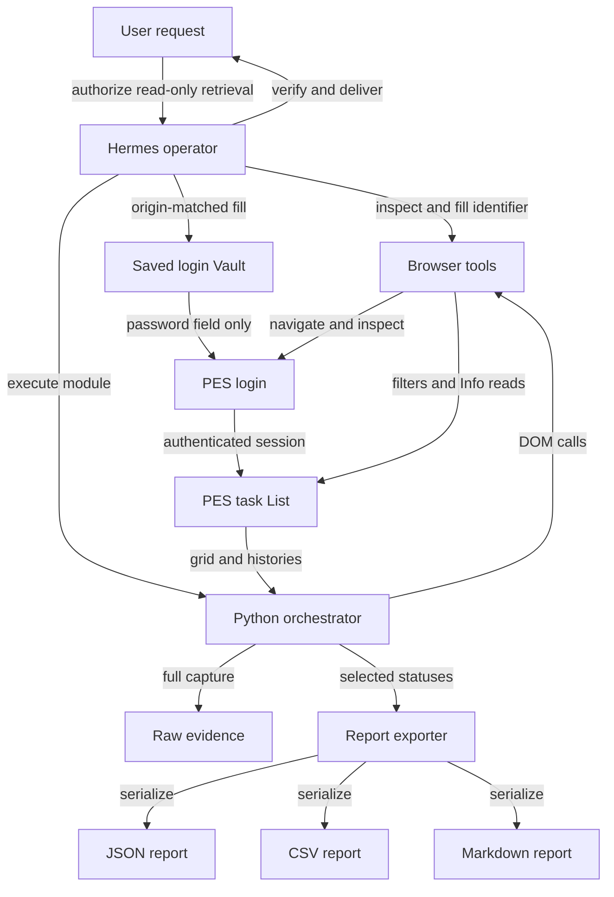
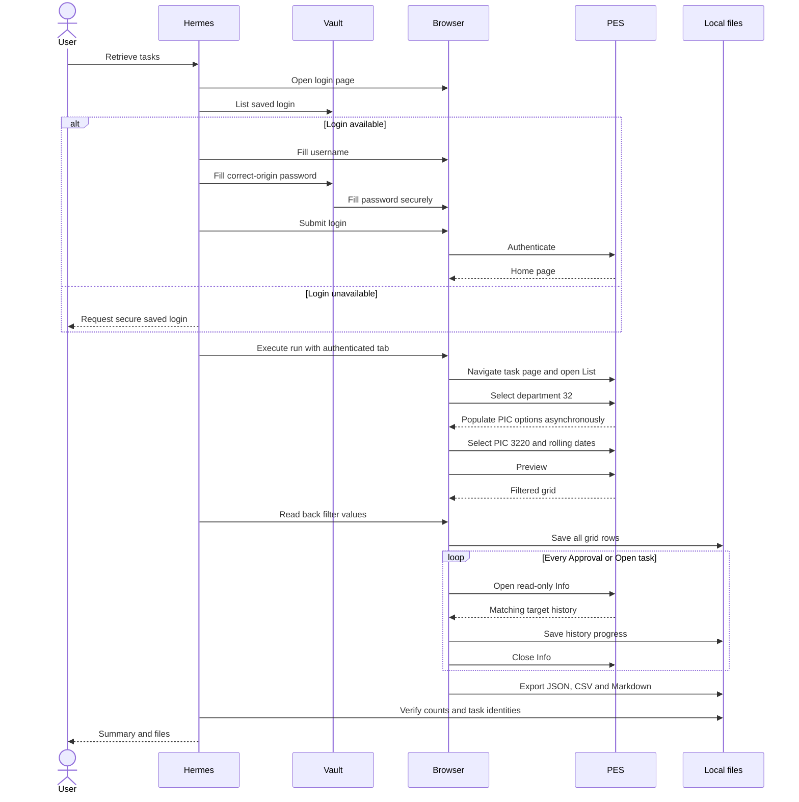
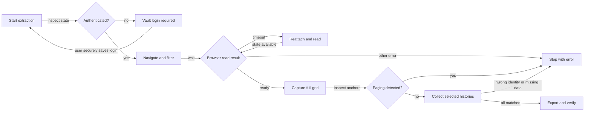

# 03 — Architecture and End-to-End Flow

[Documentation index](../README.md) · [Source](../pes_automation.py) · [Runbook](04-OPERATIONS.md)

## 1. What the system actually is

The deliverable is a Python standard-library extraction module executed inside Hermes's browser helper environment. Hermes owns browser lifecycle and Vault access. The module receives browser helper functions as a dictionary, uses DOM evaluation and form filling, and writes local artifacts.

It is not a server, REST API, standalone browser driver, scheduler, background daemon, task-management backend or replacement for PES. It does not open the Vault or submit login credentials itself. An authenticated browser is an explicit prerequisite.

## 2. Component map

| Component | Entry point | Responsibility | Persistent state |
|---|---|---|---|
| Human operator | Hermes prompt | Authorize retrieval and save login through secure UI | Vault-managed login |
| Hermes browser tools | `browser_exec(local=True)` | Browser navigation, DOM evaluation, field input, CDP access | Tool-managed browser session, not copied here |
| Vault tool | `list`, `fill` | Fill correct-origin password without exposing it | Outside workspace |
| Calendar logic | `date_window(today)` | Previous-month first / next-month last | None |
| Browser orchestrator | `run(browser, output_dir)` | Navigate, filter, verify, capture grid, read histories | Dated evidence files |
| Report exporter | `export_report(raw, histories, output, today)` | Select requested statuses, calculate overdue, write formats | JSON, CSV, Markdown |
| Regression tests | `AutomationTests` | Calendar and real-fixture export checks | Temporary generated report files |
| Reusable skill | `pes-task-extraction` | Operator procedure and pitfalls for future sessions | Active-profile skill outside workspace |
| Documentation | README and `docs/` | Explain exact observed behavior and limits | This workspace |

## 3. Architecture diagram

ASCII fallback: User → Hermes → Vault/browser → PES List → grid + Info histories → local evidence → selected-task JSON/CSV/Markdown → verified user handoff.

## 4. Browser sequence

## 5. Code-level flow

The module has three top-level functions:

### `date_window(today)`

Receives a `datetime.date`. Returns a two-date tuple. It handles variable month lengths and year rollover through standard calendar operations. It does not depend on browser state.

### `export_report(raw, histories, output, today)`

1. Creates the output directory.
2. Maps row cells into the 16 documented grid fields.
3. Selects exact list statuses Approval or Open.
4. Requires expected PIC and a corresponding history key.
5. Converts Indonesian month abbreviations used by the grid to parseable equivalents for the due-date calculation.
6. Computes overdue and nonnegative days overdue relative to `today`.
7. Rejects duplicate selected task numbers using assertions.
8. Writes structured JSON, a CSV with spreadsheet-leading-character protection, and a detailed Markdown report.
9. Returns output paths, counts and total scanned.

### `run(browser, output_dir)`

Uses `browser['js']`, `browser['fill_input']` and `browser['ensure_real_tab']`. Its nested wait helper polls at 0.3-second intervals for up to 60 seconds per wait. When a runtime error contains `timed out`, it reattaches and re-reads instead of replaying the previous action. Other runtime errors are propagated.

It verifies exact current URL equality, checks for the login URL, opens List if its filters are absent, selects the department and waits for the requested PIC option, sets dates, clears origin/status filters, clicks Preview and reads filter values back. After capturing the whole grid it refuses detected page links, verifies unique task numbers and expected PIC, then collects matching histories. History JSON is rewritten after each successful task so progress survives later failures.

## 6. Asynchronous completion model

PES uses ASP.NET asynchronous postbacks. `wait_for_load()` alone was observed to return before the List DOM changed. The module therefore checks `Sys.WebForms.PageRequestManager.getInstance().get_isInAsyncPostBack()` when that API exists, alongside required DOM conditions.

Two fixed 0.5-second delays precede polling after department change and Preview. This was live-tested, but it is not a formal network-response correlation guarantee. Extremely delayed request initiation, full-navigation context invalidation, different ASP.NET behavior or changed selectors can still fail.

## 7. Error and recovery flow

## 8. State and failure boundaries

- Website business state is not mutated by the selected controls; login and filtering still issue normal HTTP/postback requests and may affect ordinary server session/audit state.
- There is no transactional output directory. Repeated runs on the same local date overwrite the same filenames.
- A failure after writing some histories can leave partial evidence. A dated directory existing does not prove successful report completion.
- A rerun on the same day can leave an older finished report beside newer partial raw evidence if it fails before export. Operators must check timestamps, completion output and matching data.
- No screenshots, PDFs, attachment downloads, secret exports or task mutation clients were implemented.

## 9. Status distinction

**Implemented and historically live-verified:** login through the external Vault workflow, List filter flow, full current grid extraction, eight read-only histories, export, timeout readback recovery, Home-to-report execution.

**Not implemented:** autonomous login inside the script, recurring schedule, universal pagination, explicit empty-grid success, atomic output publication, full standalone CLI, CI browser harness and deployment.
